# TrueNAS Installation Guide

Tested on TrueNAS 27.0.0-RC.1.

Apps run as a built-in non-root account called `apps`, which has UID 568 and GID 568.

```console
truenas_admin@backup[~]$ getent passwd 568
apps:x:568:568:Unprivileged Apps User:/var/empty:/usr/sbin/nologin
truenas_admin@backup[~]$ getent group 568
apps:x:568:
```

For the sake of this guide, Curiarium will use datasets within `/mnt/tank/configs` on a ZFS pool called `tank`.

## Prerequisites

- The Apps service is running. The Installed page shows `Apps Service Running`.
- A ZFS pool with a `configs` dataset. This guide uses `tank/configs`.
- Shell access to the TrueNAS host, over SSH or the web shell, with `sudo` or root. The command line equivalents below need it.
- A way to reach port 5173 on the TrueNAS host from the machines that will use Curiarium.

## ZFS Datasets

Most of these steps use the TrueNAS web interface. If you prefer the command line, skip to the [command line equivalent](#command-line-equivalent) below.

1. Create a dataset called `curiarium` with the parent path `tank/configs`, giving `tank/configs/curiarium`. Set the preset to `Generic`.

   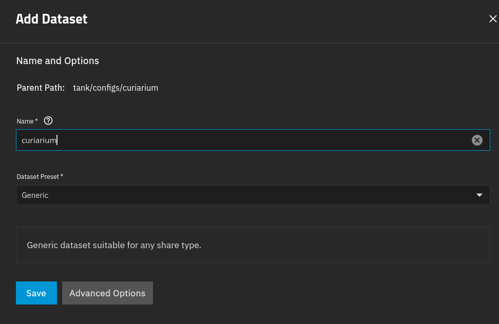

2. Add a dataset called `storage` under the `curiarium` dataset from step 1. Set the preset to `Apps`.

   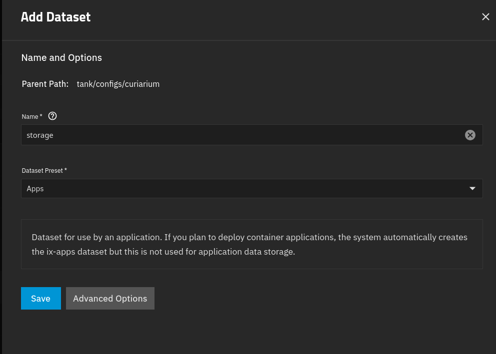

3. Add a dataset called `data` under the `curiarium` dataset from step 1. Set the preset to `Generic`.

   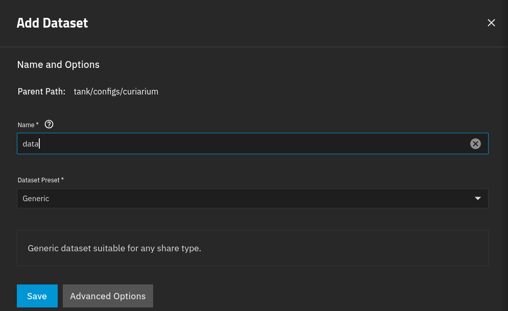

4. Open the Permissions tab for the `data` dataset and select `Edit`.

   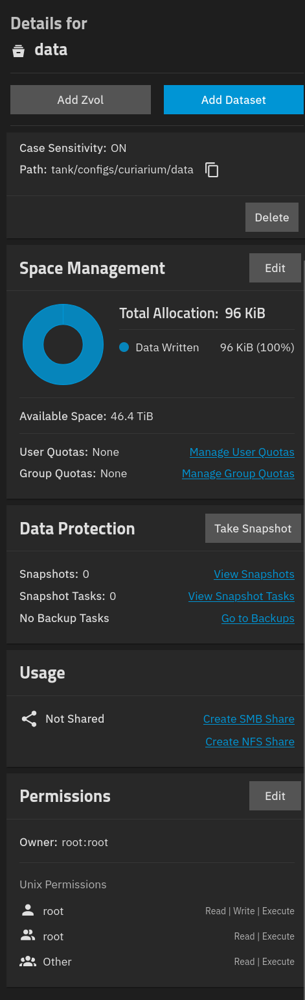

5. Set the following permissions:

   - User: `netdata`, and select `Apply User`.
   - Group: `docker`, and select `Apply Group`.
   - Access for User: Read, Write and Execute.
   - Access for Group: Read and Execute.
   - Access for Other: clear Read, Write and Execute.
   - Select `Apply permissions recursively`. Leave `Apply permissions to child datasets` cleared.

6. Select `Save`.

   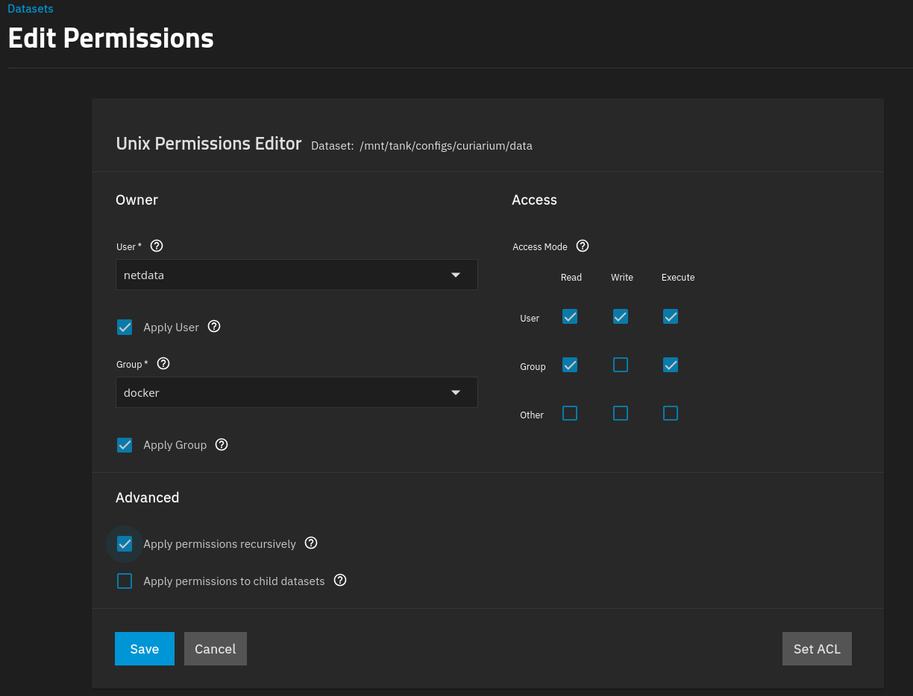

These permissions are only the starting state. When the API container starts, its entrypoint runs `chown 568:568` on `storage` and `data` (the default `CHOWN_MODE=minimal`). After the first start, both datasets are owned by `apps:apps`. The mode on `data` stays `750`, so only `apps` can read it.

### Command line equivalent

Run these as root, or with `sudo`, instead of steps 1 to 6:

```bash
sudo midclt call pool.dataset.create '{"name": "tank/configs/curiarium", "share_type": "GENERIC"}' | jq -r .mountpoint
sudo midclt call pool.dataset.create '{"name": "tank/configs/curiarium/storage", "share_type": "APPS"}' | jq -r .mountpoint
sudo midclt call pool.dataset.create '{"name": "tank/configs/curiarium/data", "share_type": "GENERIC"}' | jq -r .mountpoint

sudo midclt call -j filesystem.setperm "{
  \"path\": \"/mnt/tank/configs/curiarium/data\",
  \"uid\": $(id -u netdata),
  \"gid\": $(getent group docker | cut -d: -f3),
  \"mode\": \"750\",
  \"options\": {\"recursive\": true}
}"
```

Check the result:

```bash
zfs list -r tank/configs/curiarium
ls -ld /mnt/tank/configs/curiarium/data
nfs4xdr_getfacl /mnt/tank/configs/curiarium/storage
```

Before the app starts, the `data` dataset should be owned by `netdata:docker` with mode `drwxr-x---`. After the first start, it is owned by `apps:apps` with the same mode, and `ls` as a non-root user returns `Permission denied`. That is expected. The ACL on `storage` should include a `user:apps` entry with allow rights, because the `Apps` preset grants access to the `apps` user.

## Setup Environment

Create the `.env` file, and change `PUBLIC_URL` to suit your setup.

`PUBLIC_URL` uses HTTPS in this example, but the app itself serves plain HTTP on port 5173. An HTTPS URL needs a reverse proxy that terminates TLS and forwards all paths to port 5173. A reverse proxy such as Nginx Proxy Manager (NPM), with a Let's Encrypt certificate or another SSL certificate, is recommended. This guide does not cover setting one up; it was not configured at the time of writing. If you only reach Curiarium over HTTP on your LAN, leave `PUBLIC_URL` empty and use `CORS_ORIGINS` instead.

`CORS_ORIGINS` is optional. It is a comma-separated list of web addresses that the API allows to call it from a browser.

Browsers enforce the same-origin policy. A page loaded from one origin (scheme, host and port together) cannot read responses from a different origin, unless that server allows it with CORS headers. `http://curiarium.example.com:5173` and `http://IP:5173` are different origins, even though they reach the same server.

```bash
sudo tee /mnt/tank/configs/curiarium/.env >/dev/null <<EOF
PUID=568
PGID=568
CHOWN_MODE=minimal
FILE_STORAGE=/app/storage
DB_URL=sqlite:////app/data/curiarium.db
PUBLIC_URL=https://curiarium.example.com
# CORS_ORIGINS=http://curiarium.example.com:5173,http://IP:5173
VITE_API_URL=
AUTH_MODE=auto
# Browser first-run setup: creates the first administrator under a server-enforced
# password policy, then closes itself. Set to 0 (or remove) once that account exists.
AUTH_FIRST_RUN_SETUP=1
# Break-glass, for headless or automated installs. Inert from the moment an
# enabled administrator exists, so leaving it set is harmless.
AUTH_USERNAME=admin
AUTH_PASSWORD=change-me-to-something-strong
AUTH_SECRET=$(openssl rand -hex 32)
AUTH_ACCESS_TOKEN_TTL=900
AUTH_REFRESH_TTL_SECONDS=2592000
MAX_UPLOAD_MB=4096
EOF
```

The shell expands `$` and backticks in this heredoc. That is how `$(openssl rand -hex 32)` generates `AUTH_SECRET`, but it also corrupts an `AUTH_PASSWORD` that contains either character. If your password has one, leave `AUTH_PASSWORD` as it is in the command, then edit the file afterwards and set the real password there.

Set the file to mode `600`, owned by `apps:apps`:

```bash
sudo chown 568:568 /mnt/tank/configs/curiarium/.env
sudo chmod 600 /mnt/tank/configs/curiarium/.env
```

## Install App

Most of these steps use the TrueNAS web interface. If you prefer the command line, skip to the [command line equivalent](#command-line-equivalent-1) below.

1. Select `Discover Apps`.

   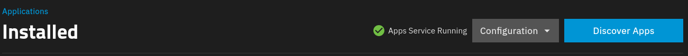

2. Select `More Options`.

   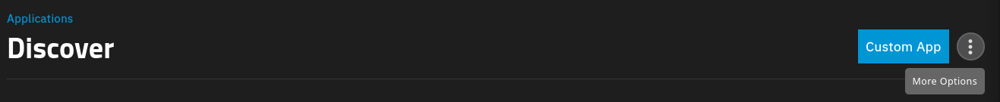

3. Select `Install via YAML`.

   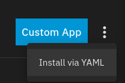

4. In the name field, enter `curiarium`. Paste the following into the `Custom Config` field:

```yaml
services:
  api:
    container_name: c_api
    devices:
      - /dev/zfs:/dev/zfs
    env_file:
      - /mnt/tank/configs/curiarium/.env
    image: ghcr.io/insanemal/curiarium-api:edge-zfs
    restart: unless-stopped
    volumes:
      - bind:
          propagation: rslave
        source: /mnt/tank/configs/curiarium/storage
        target: /app/storage
        type: bind
      - /mnt/tank/configs/curiarium/data:/app/data
  web:
    container_name: curiarium_web
    depends_on:
      - api
    env_file:
      - /mnt/tank/configs/curiarium/.env
    image: ghcr.io/insanemal/curiarium-web:edge
    ports:
      - '5173:5173'
    restart: unless-stopped

x-portals:
  - host: 0.0.0.0
    name: Web UI
    path: /
    port: 5173
    scheme: http
```

If you use HTTPS, change `scheme: http` to `scheme: https`.

### Command line equivalent

Save the YAML above as `/mnt/tank/configs/curiarium/compose.yaml`. Then create the app from it:

```bash
sudo midclt call -j app.create "$(jq -n --rawfile compose /mnt/tank/configs/curiarium/compose.yaml \
  '{app_name: "curiarium", custom_app: true, custom_compose_config_string: $compose}')"
```

Check that both containers are running:

```bash
sudo midclt call app.query '[["name","=","curiarium"]]' | jq '.[0] | {name, state}'
sudo docker ps --filter name=c_api --filter name=curiarium_web
```

### ZFS Snapshots

The `edge-zfs` API image includes the ZFS userland tools (`zfsutils-linux`). The plain `edge` image does not, so Curiarium reports "zfs could not be run" even when the dataset is set up correctly. The `/dev/zfs` device in the YAML above gives those tools access to the pool, and TrueNAS already sets up the `apps` user to manage snapshots. Snapshots of the `storage` dataset work out of the box, with no extra setup.

See [Snapshots (ZFS)](curiarium/docs/architecture/CONFIGURATION.md#snapshots-zfs) for how the ZFS provider works.

### Portal Workaround

TrueNAS 27.0.0-RC.1 does not detect portals defined in custom apps, so the `Web UI` button does not appear. Until this is fixed upstream, use the script below. It also works for other custom apps: run `/root/sync-portals.sh <APPNAME>`.

**Not tested for the command line install.** The script was written for an app installed through the web interface. When the app was created with the command line `app.create` command, TrueNAS reported the `Web UI` portal without the script. Whether the `Web UI` button appears for an app created that way, or whether the script is needed, was not tested.

Create the script:

```bash
cat > /root/sync-portals.sh <<'EOF'
#!/bin/sh
# KLUDGE: TrueNAS 27.0.0-RC.1 does not support x-portals for custom apps.
# The middleware skips portal discovery when custom_app is true (see the TODOs in
# middlewared/plugins/apps/crud.py and ix_apps/metadata.py), so the Web UI button
# never appears even though x-portals is present in the rendered compose file.
# This script calls the middleware's own portal update function by hand and then
# regenerates the collective metadata. Rerun it after creating or editing a custom app.
# Remove it once custom app portal support lands upstream.
#
# usage: sync-portals.sh <app> [<app> ...]
for APP in "$@"; do
  VER=$(midclt call app.query "[[\"name\",\"=\",\"$APP\"]]" | jq -r '.[0].version')
  python3 -c "from middlewared.plugins.apps.ix_apps.metadata import update_app_metadata_for_portals as f; f('$APP','$VER')"
done
midclt call -j app.metadata.generate
for APP in "$@"; do
  echo "$APP:"; midclt call app.query "[[\"name\",\"=\",\"$APP\"]]" | jq '.[0].portals'
done
EOF
```

Make it executable:

```bash
chmod +x /root/sync-portals.sh
```

Run it for the `curiarium` app:

```bash
/root/sync-portals.sh curiarium
```

Example output:

```console
root@backup[~]# /root/sync-portals.sh curiarium
Status: Updated metadata configuration for apps
Total Progress: [########################################] 100.00%
null
curiarium:
{
  "Web UI": "http://0.0.0.0:5173/"
}
```

## Verify

Curiarium appears in the TrueNAS Applications list with the status `Running`, and its Application Info panel shows both containers up.

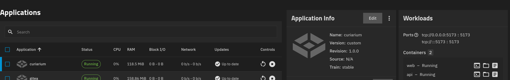

The Application Info panel also has a `Web UI` button.

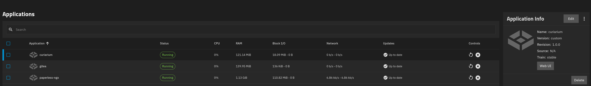

Select `Web UI`, or browse to `http://<truenas-host>:5173/`. With `AUTH_FIRST_RUN_SETUP=1` the first visit offers the one-time setup that creates your administrator — pick a strong password there, because the server enforces its own policy and closes the window the moment that account exists. Without the flag, sign in with `AUTH_USERNAME` and `AUTH_PASSWORD` from the `.env` file.

A new library is empty. The sidebar shows the signed-in user and an `ADMIN` badge.

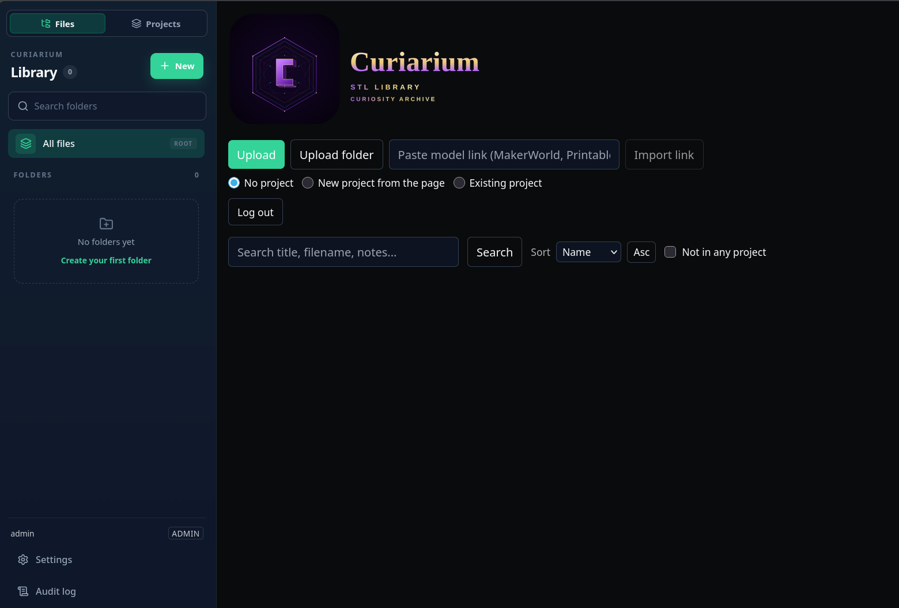

From the command line, check that the web container answers. Run this on another machine on your network, not on the TrueNAS host, because `localhost` on the host does not reach the app. Replace `<truenas-ip>` with the address of your TrueNAS host:

```bash
curl -sI http://<truenas-ip>:5173/ | head -n 1
```

The first line of the reply should be `HTTP/1.1 200 OK`.

If the app does not start, read the container logs:

```bash
sudo docker logs c_api
sudo docker logs curiarium_web
```
